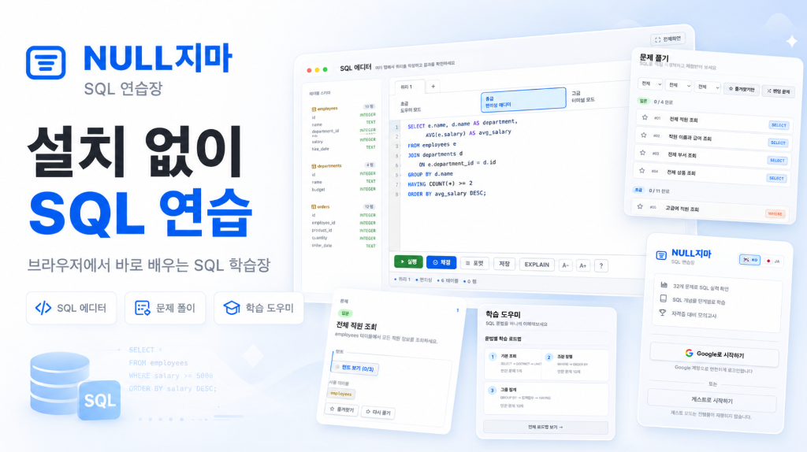
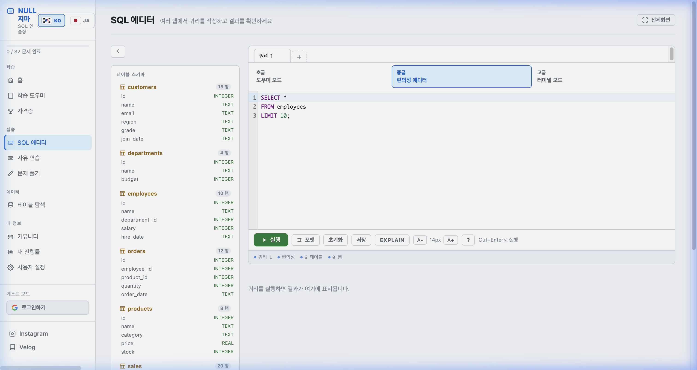

# NULL지마

실무형 샘플 데이터로 SQL을 배우고, 직접 실행하고, 문제를 풀어볼 수 있는 SQL 학습 웹앱입니다.





## 주요 기능

- SQL 스튜디오
  - 초급 도우미 모드: 문법 골격 선택
  - 중급 편의성 에디터: 자동완성, 포맷, 스키마 참고
  - 고급 터미널 모드: 콘솔형 실행 환경
- 샘플 연습
  - SQL 실행 결과 확인
  - 테이블 스키마 탐색
  - 예제 쿼리 제공
- 문제 풀이
  - 단계별 힌트
  - 정답 채점
  - 오답 원인 분석
  - 최근 작성 SQL 자동 저장
  - 즐겨찾기 / 다시 풀기 표시
- 학습 도우미
  - SELECT, WHERE, ORDER BY, GROUP BY, JOIN, 서브쿼리 학습
  - 문법별 로드맵
- 테이블 탐색
  - 테이블 컬럼 확인
  - 샘플 데이터 조회
  - ERD 관계도
- 커뮤니티 게시판
  - 질문, 풀이 공유, 팁, 자유 글 작성
  - 댓글과 추천
  - 로그인 사용자만 작성·수정·삭제·추천 가능
- 사용자 설정
  - 학습 목표, 에디터 옵션, DB 종류 선택
  - MySQL, PostgreSQL, Oracle은 준비중 상태로 표시
- 학습 데이터 동기화
  - 진행도, 즐겨찾기, 설정을 로그인 계정에 동기화
  - SQL 작업 공간은 브라우저에 자동 저장하고 초기화 가능
- 반응형 UI
  - 데스크톱 사이드바 레이아웃
  - 모바일 하단 탭 레이아웃

## 기술 스택

- React
- Vite
- sql.js
- CodeMirror
- Firebase
- ESLint

## 실행 방법

```bash
nvm use
npm install
npm run dev
```

Node.js 20.19 이상 또는 22.12 이상을 사용합니다. `.nvmrc`의 권장 버전은 Node.js 20.20.2입니다.

개발 서버가 실행되면 아래 주소로 접속합니다.

```text
http://localhost:5173
```

## 빌드

```bash
npm run build
```

## 검사

```bash
npm test
npm run lint
npm run build
```

## Firebase 배포

변경 내용을 먼저 커밋하고 GitHub에 푸시한 뒤 배포합니다. Hosting 배포 직전에 최신 소스를 자동으로 빌드합니다.

```bash
firebase deploy --only hosting,firestore:rules --project null-jima
```

`/release.json`에서 배포된 Git 커밋과 빌드 시각을 확인할 수 있습니다.

## 검색 최적화

- 빌드 시 공개 학습 본문을 포함한 페이지별 HTML을 생성합니다. JavaScript 실행 전에도 문법 설명, 예제, 문제 내용을 읽을 수 있습니다.
- 한국어는 기존 주소를, 일본어는 `/ja` 주소를 사용합니다. 페이지마다 언어별 canonical URL과 양방향 hreflang을 지정합니다.
- 페이지별 제목, 설명, Open Graph, Twitter 공유 정보와 JSON-LD를 생성합니다. 공유 이미지는 저장소의 실제 앱 화면을 사용합니다.
- `/sitemap.xml`에는 공개 학습 페이지만 포함합니다. 진행률, 사용자 설정, 로그인과 모의고사 실행 화면은 `noindex`로 설정합니다.
- `/robots.txt`에서 사이트맵을 안내하며, 존재하지 않는 주소에는 실제 HTTP 404를 반환합니다.
- 공개 학습은 로그인 없이 이용할 수 있습니다. 로그인과 커뮤니티 쓰기 권한은 기존 Firebase 인증을 사용합니다.

[Google Search Console](https://search.google.com/search-console)에 `https://null-jima.web.app/sitemap.xml`을 제출해 색인 상태를 확인할 수 있습니다.

커뮤니티 공식 예시 글은 관리자 인증 정보가 준비된 환경에서만 등록합니다.

```bash
npm run seed:community
```

## 프로젝트 구조

```text
src/
  components/   공통 UI 컴포넌트
  contexts/     인증 컨텍스트
  data/         학습 콘텐츠와 문제 데이터
  lib/          DB, 채점, 진행률, 설정 유틸
  pages/        라우트 페이지
public/         정적 리소스
docs/images/    README 이미지
```

## 레포지터리

[donghyuk0605/null-jima](https://github.com/donghyuk0605/null-jima)

## 소셜 링크

- **Instagram**: [donghyuk65](https://www.instagram.com/donghyuk65)
- **Velog**: [@donghyuk65](https://velog.io/@donghyuk65)
